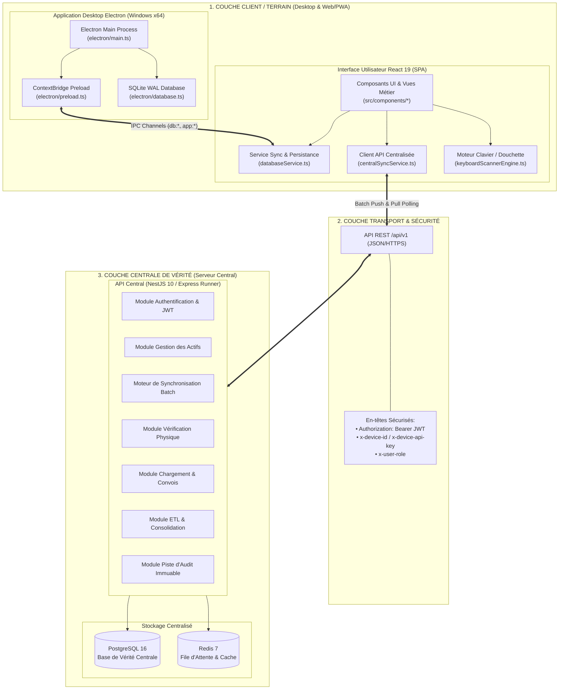
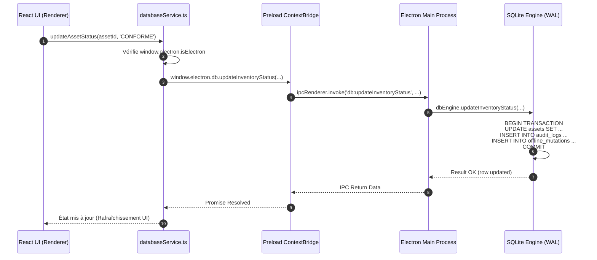
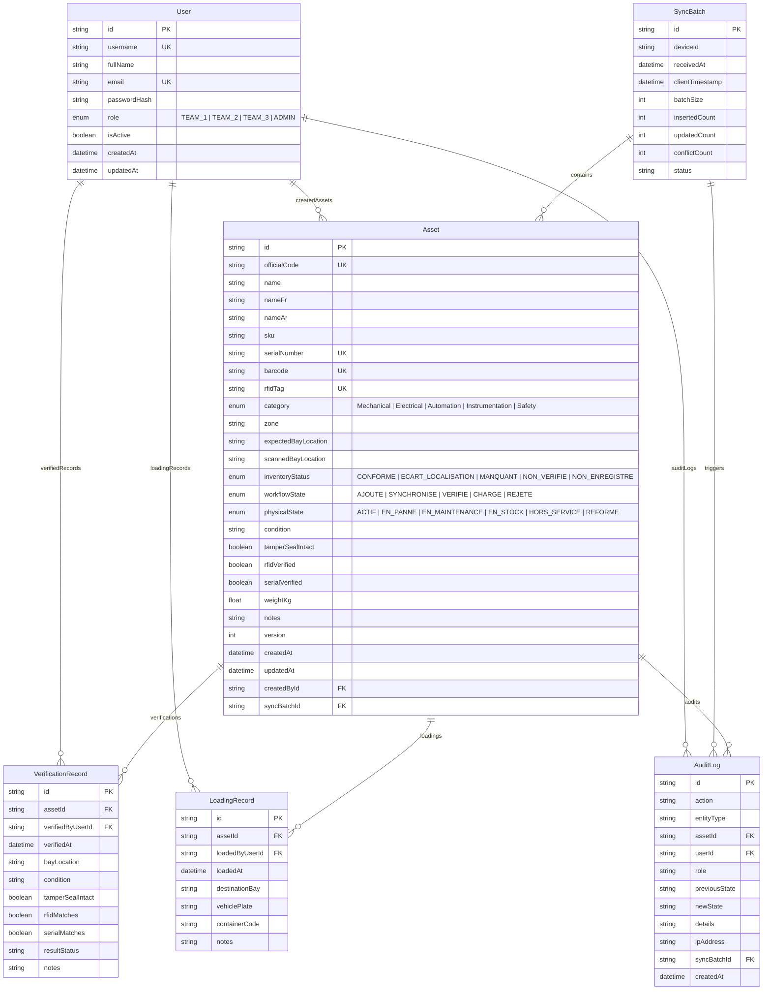
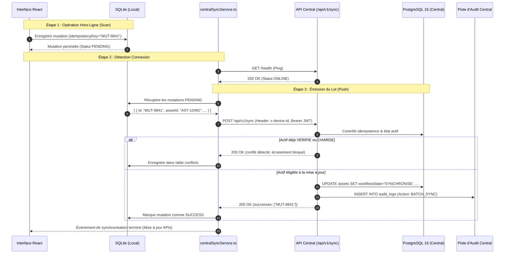

# DOCUMENTATION TECHNIQUE DE L’ARCHITECTURE DU SYSTÈME KAF-INVENTAIRE

**Version du document :** 1.0.0  
**Statut du système :** Opérationnel & Vérifié  
**Technologies principales :** React 19, TypeScript, Vite, Tailwind CSS v4, Electron, SQLite (moteur local offline), NestJS 10 / Express (moteur API), Prisma 5, PostgreSQL 16, Redis 7.

---

## 1. Vue d’Ensemble et Objectifs du Système

**KAF-INVENTAIRE** est une solution industrielle intégrée dédiée à la gestion, la traçabilité physique, l'audit contradictoire et la synchronisation des actifs et immobilisations critiques d'installations industrielles et d'entrepôts de grande envergure.

Le système répond à quatre impératifs majeurs :
1. **Fonctionnement Offline-First & Résilience Terrain :** Permettre aux équipes sur le terrain (terminaux durcis Windows / tablettes) de recenser, scanner (codes-barres 1D/2D, RFID UHF) et vérifier les actifs en l'absence totale de réseau, avec persistance locale sécurisée (SQLite WAL & IndexedDB fallback).
2. **Synchronisation Asynchrone & Idempotente :** Garantir la propagation bidirectionnelle des mutations vers une base centrale de vérité (PostgreSQL 16) sans écrasement anarchique ni perte d'intégrité.
3. **Gouvernance Multi-Équipes & Matrice RBAC Stricte :** Séparer les privilèges entre l'équipe de recensement/création (TEAM_1), l'équipe de contrôle et de vérification physique (TEAM_2), l'équipe logistique de chargement (TEAM_3) et l'administrateur du patrimoine (ADMIN).
4. **Immuabilité et Piste d'Audit (Audit Trail) :** Journaliser chaque lecture, chaque modification d'état physique ou d'emplacement, et bloquer toute régression de workflow (ex: interdiction d'écraser un actif vérifié ou chargé).

---

## 2. Architecture Générale du Système

Le système est architecturé selon un modèle hybride **Local-First / Serveur Centralisé** articulé en 3 couches principales :



### Rôles et Responsabilités des Composants

| Composant | Rôle Architectural | Entrées | Sorties | Dépendances |
| :--- | :--- | :--- | :--- | :--- |
| **Electron Main (`electron/main.ts`)** | Processus hôte Windows, gestion de la fenêtre Chromium, cycle de vie OS, initialisation du moteur SQLite local. | Événements système, messages IPC du renderer. | Réponses IPC, fenêtres natives, transactions SQLite. | `electron`, `better-sqlite3`, `node:path`, `node:fs`. |
| **Electron Preload (`electron/preload.ts`)** | Pont sécurisé isolant le renderer (`contextIsolation: true`, `nodeIntegration: false`). | Appels de l'application React. | Messages sérialisés vers `ipcRenderer`. | `electron.contextBridge`. |
| **Moteur SQLite (`electron/database.ts`)** | Moteur de données local haute performance (WAL mode) pour l'opérationnel hors-ligne. | Requêtes de lecture/écriture, mutations offline. | Jeux d'enregistrements locaux, statut de conformité. | `better-sqlite3` ou fallback `sqlite3`. |
| **Frontend React 19 (`src/`)** | Interface riche tactile et clavier (Poste de pilotage, Terminal Scanner, Rapprochement, Carte de zone, File offline). | Saisies utilisateur, tirs scanner, synchronisation. | Mutations locales, requêtes API, impressions d'étiquettes. | `react`, `lucide-react`, `motion`, `tailwindcss`. |
| **CentralSyncService (`src/services/centralSyncService.ts`)** | Client HTTP orchestrateur de la synchronisation asynchrone, santé, authentification et journalisation réseau. | Mutations de la file d'attente locale, filtres de recherche. | Payloads `/api/v1/sync`, jetons JWT, logs d'appels. | API Fetch standard du navigateur. |
| **Backend NestJS (`backend/src/`)** | Cœur applicatif centralisé, garant des règles métier, de l'idempotence et du blocage des régressions de workflow. | Requêtes HTTP REST de tous les terminaux. | Données d'actifs consolidées, rapports de batch sync. | `@nestjs/core`, `@prisma/client`, `class-validator`. |
| **Express Fullstack (`server.ts`)** | Serveur unifié de développement et prévisualisation intégrant à la fois les routes `/api/v1` et les middlewares Vite HMR. | Requêtes client, chargement des modules TypeScript. | Bundle Vite injecté, réponses JSON REST conformes NestJS. | `express`, `vite`, `crypto`. |

---

## 3. Architecture du Frontend (React 19 & TypeScript)

### 3.1 Point d’entrée et Structure

- **Framework :** React 19 (Hooks fonctionnels purs, strict mode)
- **Langage :** TypeScript 5.7+
- **Outillage :** Vite 8 avec intégration Tailwind CSS v4 via `@tailwindcss/vite`
- **Directionnalité (i18n) :** Bilingue Français (`fr`) et Arabe (`ar`) avec bascule automatique de `dir="rtl"` / `dir="ltr"` sur `<html>`.
- **Navigation :** Navigation interne par onglets via état central (`ActiveScreen`) avec raccourcis clavier industriels globaux (Alt+1 à Alt+9, Alt+0, Alt+U, Alt+S, Alt+M).

### 3.2 Arborescence Fonctionnelle du Frontend

```
/src/
├── App.tsx                     # Chef d'orchestre de l'application, routage d'écrans, gestion des raccourcis
├── main.tsx                    # Point d'entrée DOM React (createRoot)
├── index.css                   # Feuille de styles globale Tailwind v4 & animations radar
├── types.ts                    # Interfaces de données TypeScript (Assets, Mutations, Conflits, RBAC, etc.)
├── mockData.ts                 # Jeu de données d'amorçage réaliste (actifs algériens, campagnes, anomalies)
├── translations.ts             # Dictionnaire complet de localisation FR / AR
├── components/                 # Composants d'interface métier
│   ├── TopOperationalStrip.tsx         # Barre supérieure : état réseau, indicateurs KPI, sélecteur de rôle/langue
│   ├── RightSidebar.tsx                # Tiroir latéral droit : aide, configuration Henex, raccourcis
│   ├── ReconciliationCockpit.tsx       # Écran 1 : Matrice de rapprochement, filtres et liste des immobilisations
│   ├── AssetInspector.tsx              # Volet d'inspection détaillée de l'actif sélectionné
│   ├── FieldScannerTerminal.tsx        # Écran 2 : Terminal de saisie rapide au pistolet / clavier physique
│   ├── UnregisteredDiscoveriesView.tsx # Écran 3 : Gestion des actifs trouvés in situ sans identification
│   ├── CampaignManagementView.tsx      # Écran 4 : Pilotage des campagnes et clôture contradictoire des travées
│   ├── WarehouseMapView.tsx            # Écran 5 : Carte visuelle 2D des allées/racks avec statut de progression
│   ├── OfflineQueueView.tsx            # Écran 6 : File d'attente des mutations locales et résolution des conflits
│   ├── AuditTrailView.tsx              # Écran 7 : Piste d'audit immuable horodatée (ISO 8601)
│   ├── ChecklistValidationView.tsx     # Écran 8 : Cahier de validation des 9 scénarios de conformité terrain
│   ├── AuditReportManifest.tsx         # Écran 9 : Rapport officiel d'inventaire contradictoire (exportable)
│   ├── DesktopDatabaseCenter.tsx       # Écran 0 : Centre de contrôle SQLite (WAL, VACUUM, sauvegarde, export)
│   ├── UserManagementView.tsx          # Écran U : Gestion des utilisateurs locaux et matrice RBAC
│   ├── BackendSyncCenterView.tsx       # Écran S : Cockpit de synchronisation centrale (test des 8 fonctions)
│   ├── NewAssetModal.tsx               # Modal de création manuelle d'un actif (Équipe 1 / Admin)
│   ├── HenexConfigModal.tsx            # Configuration du scanner matériel (préfixe, suffixe, vitesse)
│   ├── TicketPrintModal.tsx            # Module de prévisualisation et d'impression d'étiquette thermique
│   ├── PhysicalAssetTag.tsx            # Rendu visuel d'une étiquette industrielle (Code 128, QR, Datamatrix)
│   ├── OfflineQueueBanner.tsx          # Bandeau d'alerte signalant des mutations en attente d'émission
│   ├── UserRoleIcon.tsx                # Badge graphique du rôle utilisateur
│   └── KafLogo.tsx                     # Composant vectoriel de la marque KAF
├── security/                   # Module de contrôle d'accès
│   ├── authService.ts          # Authentification locale et gestion des sessions actives
│   ├── permissions.ts          # Matrice de correspondance rôles <-> privilèges
│   └── crypto.ts               # Utilitaires de signature et d'intégrité
├── services/                   # Services de persistance et transport
│   ├── databaseService.ts      # Abstraction d'accès unifié : SQLite (si sous Electron) sinon LocalStorage
│   └── centralSyncService.ts   # Client HTTP pour l'API REST centrale (PostgreSQL/Redis)
└── utils/                      # Outils transversaux
    ├── audio.ts                # Synthétiseur de bips sonores industriels (Web Audio API)
    ├── keyboardScannerEngine.ts# Détecteur de flux rapide simulant une douchette laser/CCD (délai < 50ms)
    ├── pureBarcode.tsx         # Rendu vectoriel SVG pur de codes-barres Code 128 sans librairie externe
    └── ticketParser.ts         # Parseur de chaînes concaténées provenant d'étiquettes complexes
```

### 3.3 Diagramme des Dépendances Frontend

```mermaid
graph TD
    App[App.tsx] --> TopOperationalStrip
    App --> RightSidebar
    App --> ReconciliationCockpit
    App --> FieldScannerTerminal
    App --> UnregisteredDiscoveriesView
    App --> CampaignManagementView
    App --> WarehouseMapView
    App --> OfflineQueueView
    App --> AuditTrailView
    App --> ChecklistValidationView
    App --> AuditReportManifest
    App --> DesktopDatabaseCenter
    App --> UserManagementView
    App --> BackendSyncCenterView
    App --> NewAssetModal

    ReconciliationCockpit --> AssetInspector
    ReconciliationCockpit --> PhysicalAssetTag
    FieldScannerTerminal --> keyboardScannerEngine
    FieldScannerTerminal --> TicketPrintModal
    TicketPrintModal --> pureBarcode

    App --> databaseService
    App --> centralSyncService
    App --> authService
    App --> sound[utils/audio.ts]

    databaseService -.->|"Si Electron Détecté"| window_electron["window.electron.db"]
    databaseService -.->|"Si Navigateur Pur"| localStorage["LocalStorage / IndexedDB"]
    centralSyncService --> fetchAPI["fetch('/api/v1/*')"]
```



---

## 4. Architecture de l’Application Desktop Electron

L’application de bureau KAF-INVENTAIRE est conçue pour fonctionner sous Windows (7, 10, 11 en x64) avec une étanchéité totale aux défaillances réseau.

### 4.1 Processus Principal (`electron/main.ts`)
- **Initialisation sécurisée :** Création d'une `BrowserWindow` (1400x900) avec `contextIsolation: true`, `nodeIntegration: false`, `sandbox: false`.
- **Gestionnaire du moteur SQLite :** Instanciation de `LocalSQLiteEngine` ciblant le répertoire `%APPDATA%/kaf-data/kaf_inventaire.db`.
- **Gestionnaires IPC (`ipcMain.handle`) :**
  - **Statistiques & Santé :** `db:getStats`, `db:runIntegrityCheck`, `db:vacuum`.
  - **Gestion des Actifs :** `db:getAssets`, `db:getAssetById`, `db:searchAssets`, `db:createAsset`, `db:updateAsset`, `db:updateInventoryStatus`.
  - **Découvertes & Anomalies :** `db:getDiscoveries`, `db:createDiscovery`, `db:updateDiscovery`.
  - **Campagnes & Audit :** `db:getCampaign`, `db:updateCampaign`, `db:getAuditLogs`, `db:addAuditLog`.
  - **File d'Attente Offline :** `db:getMutations`, `db:addMutation`, `db:updateMutationStatus`, `db:clearPendingMutations`.
  - **Conflits & Arbitrage :** `db:getConflicts`, `db:resolveConflict`.
  - **Maintenance OS :** `db:backupDatabase`, `db:restoreDatabase`, `db:exportJson`, `app:openExternal`.

### 4.2 Script Preload (`electron/preload.ts`)
Le script de préchargement expose l'objet immuable `window.electron` au contexte de la page via `contextBridge.exposeInMainWorld` :

```typescript
// Extrait de l'interface exposée
window.electron = {
  isElectron: true,
  platform: 'win32',
  db: {
    getStats: () => ipcRenderer.invoke('db:getStats'),
    getAssets: () => ipcRenderer.invoke('db:getAssets'),
    createAsset: (asset) => ipcRenderer.invoke('db:createAsset', asset),
    updateInventoryStatus: (id, status, bay, user) => ipcRenderer.invoke('db:updateInventoryStatus', id, status, bay, user),
    addMutation: (mutation) => ipcRenderer.invoke('db:addMutation', mutation),
    // ...
  },
  system: {
    printThermalTicket: (payload) => ipcRenderer.invoke('system:printThermalTicket', payload),
    openPath: (path) => ipcRenderer.invoke('system:openPath', path)
  }
};
```

### 4.3 Flux d'Exécution IPC



---

## 5. Architecture du Backend Central

Le backend central de KAF-INVENTAIRE est configuré pour un déploiement conteneurisé moderne (Node.js 20, NestJS 10, Prisma 5, PostgreSQL 16 Alpine, Redis 7 Alpine), avec un double lanceur de développement (`server.ts`) permettant l'exécution immédiate en environnement isolé.

### 5.1 Modules Métier NestJS (`backend/src/`)

```
/backend/src/
├── main.ts                     # Point d'entrée de l'application NestJS, Helmet, CORS, ValidationPipe
├── app.module.ts               # Module racine assemblant tous les modules métier
├── app.controller.ts           # Contrôleur d'infrastructure (Health check, ping)
├── prisma/
│   └── prisma.service.ts       # Service d'injection et gestion du cycle de vie PrismaClient
├── common/
│   ├── enums.ts                # Énumérations strictes (UserRole, WorkflowState, PhysicalState, InventoryStatus)
│   ├── decorators/
│   │   └── roles.decorator.ts  # Décorateur @Roles(...) pour la sécurité déclarative
│   └── guards/
│       ├── jwt-auth.guard.ts   # Guard de validation des jetons JWT et extraction du Principal
│       └── roles.guard.ts      # Guard d'application de la matrice RBAC
├── auth/                       # Module Authentification
│   ├── auth.module.ts
│   ├── auth.service.ts         # Vérification mot de passe (bcrypt) et émission de JWT
│   ├── auth.controller.ts      # Endpoints POST /auth/login, POST /auth/refresh, GET /auth/profile
│   └── dto/login.dto.ts
├── assets/                     # Module Immobilisations
│   ├── assets.module.ts
│   ├── assets.service.ts       # Filtrage, recherche textuelle, création unitaire, audit
│   ├── assets.controller.ts    # Endpoints GET /assets, GET /assets/:id, POST /assets
│   └── dto/create-asset.dto.ts
├── sync/                       # Moteur de Synchronisation Batch
│   ├── sync.module.ts
│   ├── sync.service.ts         # Déballage de lots, détection de doublons, blocage de conflits
│   ├── sync.controller.ts      # Endpoints POST /sync, GET /sync/status
│   └── dto/sync-batch.dto.ts
├── verification/               # Module Contrôle Physique Terrain
│   ├── verification.module.ts
│   ├── verification.service.ts # Validation in situ, passage d'état à VERIFIE
│   ├── verification.controller.ts # Endpoint POST /verification/:id (réservé TEAM_2 / ADMIN)
│   └── dto/verify-asset.dto.ts
├── loading/                    # Module Chargement Logistique
│   ├── loading.module.ts
│   ├── loading.service.ts      # Association véhicule/convoi, passage d'état à CHARGE
│   ├── loading.controller.ts   # Endpoint POST /loading/:id (réservé TEAM_3 / ADMIN)
│   └── dto/load-asset.dto.ts
├── etl/                        # Module ETL & Consolidation
│   ├── etl.module.ts
│   ├── etl.service.ts          # Import de masse JSON/CSV, déduplication, calcul des KPIs
│   └── etl.controller.ts       # Endpoints POST /etl/import, GET /etl/stats
└── audit/                      # Module Piste d'Audit
    ├── audit.module.ts
    ├── audit.service.ts        # Requêtage immuable de l'historique complet
    └── audit.controller.ts     # Endpoint GET /audit
```

### 5.2 Diagramme des Modules Backend

```mermaid
graph TD
    AppModule[AppModule] --> AuthModule[AuthModule]
    AppModule --> AssetsModule[AssetsModule]
    AppModule --> SyncModule[SyncModule]
    AppModule --> VerificationModule[VerificationModule]
    AppModule --> LoadingModule[LoadingModule]
    AppModule --> EtlModule[EtlModule]
    AppModule --> AuditModule[AuditModule]
    AppModule --> PrismaModule[PrismaModule (PrismaService)]

    AuthModule --> PrismaModule
    AssetsModule --> PrismaModule
    SyncModule --> PrismaModule
    VerificationModule --> PrismaModule
    LoadingModule --> PrismaModule
    EtlModule --> PrismaModule
    AuditModule --> PrismaModule

    PrismaModule --> PostgreSQL[(PostgreSQL 16)]
```

---

## 6. Architecture des Bases de Données

Le système maintient une stricte cohérence sémantique entre la base **SQLite locale** (terminal) et la base **PostgreSQL 16 centrale** (serveur de vérité).

### 6.1 Schéma Relationnel PostgreSQL (Prisma 5)



### 6.2 Schéma SQLite Local (`electron/database.ts`)

| Table SQLite | Rôle Métier | Clé Primaire & Index |
| :--- | :--- | :--- |
| `assets` | Copie locale du catalogue d'actifs opérationnels. | PK: `id`. Index: `officialCode`, `barcode`, `serialNumber`, `inventoryStatus`, `expectedBayLocation`. |
| `discoveries` | Actifs physiques détectés sur le terrain sans étiquette d'origine. | PK: `id`. Index: `status`. |
| `campaigns` | Campagnes d'inventaire actives et clôturées. | PK: `id`. |
| `zones` | Travées / allées de l'entrepôt et état de clôture contradictoire. | PK: `id`. |
| `audit_logs` | Journal immuable des événements horodatés locaux. | PK: `id`. Index: `timestamp`. |
| `offline_mutations` | File d'attente FIFO persistante des opérations à émettre. | PK: `id`. Unique: `idempotencyKey`. Index: `syncStatus`. |
| `conflicts` | Enregistrements bloqués par le serveur pour arbitrage humain. | PK: `id`. |
| `app_settings` | Clé/Valeur de configuration locale (clé appareil, URL centrale). | PK: `key`. |
| `checklist` | Les 9 scénarios de test du cahier de validation. | PK: `id`. |
| `users` | Comptes utilisateurs locaux autorisés hors ligne. | PK: `id`. Unique: `username`. |

### 6.3 Comparaison et Alignement des Deux Schémas

1. **Cohérence des Identifiants :** Les deux bases utilisent des identifiants alphanumériques universels (`AST-XXXXX` ou UUID v4).
2. **Gestion de Version Optimiste :** La colonne `version` (entier incrémentiel) sur `assets` permet la détection fine des écritures concurrentes.
3. **Idempotence :** La contrainte d'unicité sur `idempotencyKey` de la table des mutations garantit qu'un rejeu réseau ou une coupure Wi-Fi ne produira jamais de doublon.

---

## 7. Architecture de Synchronisation et Offline-First

Le mécanisme de synchronisation de KAF-INVENTAIRE repose sur une politique de **Push asynchrone par lot** avec **garantie de non-régression de workflow**.

### 7.1 Cycle de Vie d’une Mutation

1. **Capture Locale :** Lors d'un scan ou d'une modification sur le terminal, la mutation est immédiatement inscrite en transaction SQLite locale dans `offline_mutations` avec `syncStatus = 'PENDING'`. L'interface réagit instantanément (0 ms de latence).
2. **Détection de Connectivité :** Le service `centralSyncService` vérifie la connectivité via un ping régulier sur `/api/v1/health`.
3. **Émission par Lot (`POST /api/v1/sync`) :** Dès que le terminal est `ONLINE`, le lot de mutations en attente est sérialisé et expédié avec l'empreinte d'appareil (`x-device-id`, `x-device-api-key`).
4. **Validation Côté Serveur (Règles d'Arbitrage Automatique) :**
   - **Vérification d'Idempotence :** Si l'identifiant de la mutation a déjà été traité (`processedMutationIds`), il est classé en `duplicate` et ignoré sans erreur.
   - **Contrôle de Conflit de Workflow (Règle Métier Majeure) :** Si l'actif ciblé est déjà à l'état `VERIFIE` (validé par l'Équipe 2) ou `CHARGE` (validé par l'Équipe 3), le serveur **refuse formellement l'écrasement** par une mutation locale de l'Équipe 1. La mutation est rejetée en conflit explicite avec le détail de l'état serveur.
   - **Application Nominale :** Si l'actif est `AJOUTE` ou `SYNCHRONISE`, ses champs physiques sont mis à jour, son état passe à `SYNCHRONISE`, et un journal d'audit central est généré.
5. **Acquittement & Purge :** Le terminal reçoit le rapport de synchronisation. Les mutations réussies passent à `SUCCESS` et sont retirées de la file d'attente active ; les conflits sont injectés dans l'écran d'arbitrage.

### 7.2 Diagramme de Séquence de la Synchronisation



---

## 8. Sécurité et Contrôle d'Accès (RBAC)

Le système implémente une matrice de sécurité stricte, tant au niveau du contrôle d'accès dans l'interface (désactivation ou masquage contextuel) qu'au niveau des guards d'API NestJS (`RolesGuard`).

### 8.1 Matrice des Rôles et Permissions

| Rôle | Rôle Métier | Point d'Accès Privilégié | Permissions Accordées | Restrictions Strictes |
| :--- | :--- | :--- | :--- | :--- |
| **TEAM_1** | Équipe de Recensement / Saisie | Application Desktop Electron (Offline) | `CREATE_ASSET`, `VIEW_ASSETS`, `SYNC` | Interdiction formelle de vérifier (`VERIFY_ASSET`) ou de charger (`LOAD_ASSET`). |
| **TEAM_2** | Contrôleurs de Zone / Auditeurs | Portail Web / Tablette | `VIEW_ASSETS`, `VERIFY_ASSET` | Ne peut pas créer de nouveaux actifs ni procéder au chargement convoi. |
| **TEAM_3** | Opérateurs Logistiques / Convois | PWA Mobile | `VIEW_ASSETS`, `LOAD_ASSET` | Accès restreint uniquement aux actifs préalablement vérifiés. |
| **ADMIN** | Responsable du Patrimoine | Console Centrale Super-Admin | `TOUTES LES PERMISSIONS` + `ETL_IMPORT`, `REPORTS`, `USER_MGMT` | Aucune restriction. |

### 8.2 Sécurité Réseau et Terminaux
- **Authentification Matérielle :** Chaque terminal terrain s'identifie au moyen du couple d'en-têtes HTTP `x-device-id` (ex: `TERM-WH-01`) et `x-device-api-key` (ex: `dev_key_alpha_9921`).
- **Jetons de Session :** Les sessions opérateurs utilisent des jetons signés HMAC-SHA256 (JWT) expirant sous 24 heures et encapsulant l'identifiant, le rôle et le tableau de privilèges.

---

## 9. Matrice des Endpoints API Central (`/api/v1`)

| Méthode | Endpoint | Rôle Requis | Description Métier | Code Succès |
| :--- | :--- | :--- | :--- | :--- |
| `GET` | `/api/v1/health` | Public / Device | Diagnostic de l'infrastructure (PostgreSQL, Redis, statistiques). | 200 OK |
| `GET` | `/api/v1/sync/status` | Public / Device | État d'enregistrement du terminal et compteurs de workflow. | 200 OK |
| `POST` | `/api/v1/auth/login` | Public | Authentification par identifiant ou sélection de rôle. | 200 OK |
| `GET` | `/api/v1/assets` | Tout rôle | Récupération paginée et filtrée des actifs centraux. | 200 OK |
| `GET` | `/api/v1/assets/:id` | Tout rôle | Fiche complète d'une immobilisation avec historique. | 200 OK |
| `POST` | `/api/v1/assets` | `TEAM_1`, `ADMIN` | Création d'une nouvelle immobilisation (statut initial `AJOUTE`). | 201 Created |
| `POST` | `/api/v1/sync` | `TEAM_1`, `ADMIN` | Ingestion d'un lot de mutations offline avec contrôle anti-conflit. | 200 OK |
| `POST` | `/api/v1/verification/:id` | `TEAM_2`, `ADMIN` | Validation contradictoire in situ (passe l'actif à `VERIFIE`). | 200 OK |
| `POST` | `/api/v1/loading/:id` | `TEAM_3`, `ADMIN` | Validation logistique d'embarquement (passe l'actif à `CHARGE`). | 200 OK |
| `POST` | `/api/v1/etl/import` | `ADMIN` | Ingestion en masse de données patrimoniales et déduplication. | 201 Created |
| `GET` | `/api/v1/etl/stats` | `ADMIN` | Tableau de bord décisionnel des immobilisations par catégorie/zone. | 200 OK |
| `GET` | `/api/v1/audit` | `ADMIN` | Journal d'audit centralisé immuable pour conformité commissaire aux comptes. | 200 OK |

---

## 10. Guide de Déploiement et d'Exécution

### 10.1 Mode Prévisualisation / Développement Tout-en-Un
```bash
# Lancement du serveur unifié (API Express + Vite HMR)
npm run dev
# L'application est accessible sur http://localhost:3000
```

### 10.2 Compilation de l'Application Desktop Electron Windows
```bash
# 1. Compilation des scripts TypeScript Electron (Main & Preload)
npm run build:electron

# 2. Lancement en mode développement connecté à Vite
npm run electron:dev

# 3. Génération de l'installeur Windows (.exe NSIS) et de l'exécutable portable
npm run electron:build:win
# Les exécutables sont générés dans le dossier dist-electron/
```

### 10.3 Déploiement Conteneurisé du Backend Central
```bash
# Dans le sous-dossier backend/
cd backend

# Lancement des conteneurs PostgreSQL 16, Redis 7 et NestJS API
docker-compose up -d

# Application des migrations Prisma et amorçage des données
npx prisma migrate dev --name init
npm run seed
```

---

## 11. Analyse Critique et Recommandations d'Évolution

1. **Généralisation de WebSockets (Socket.IO) :**
   * *Constat actuel :* La synchronisation s'effectue en polling/push HTTP déclenché par les actions utilisateur.
   * *Recommandation :* Activer un canal WebSocket bidirectionnel pour notifier en temps réel les terminaux dès qu'une zone est clôturée par un contrôleur (TEAM_2).
2. **Signature Numérique des Pistes d'Audit :**
   * *Constat actuel :* La table `audit_logs` est protégée par transaction et clés étrangères.
   * *Recommandation :* Implémenter un chaînage cryptographique SHA-256 (blockchain-like local) garantissant l'inviolabilité absolue des journaux présentés aux commissaires aux comptes.
3. **Partitionnement PostgreSQL pour Gros Volumes :**
   * *Constat actuel :* Les tables sont indexées sur les codes officiels et codes-barres.
   * *Recommandation :* Au-delà de 500 000 actifs, partitionner la table `audit_logs` par année fiscale et la table `assets` par zone géographique / site industriel.
